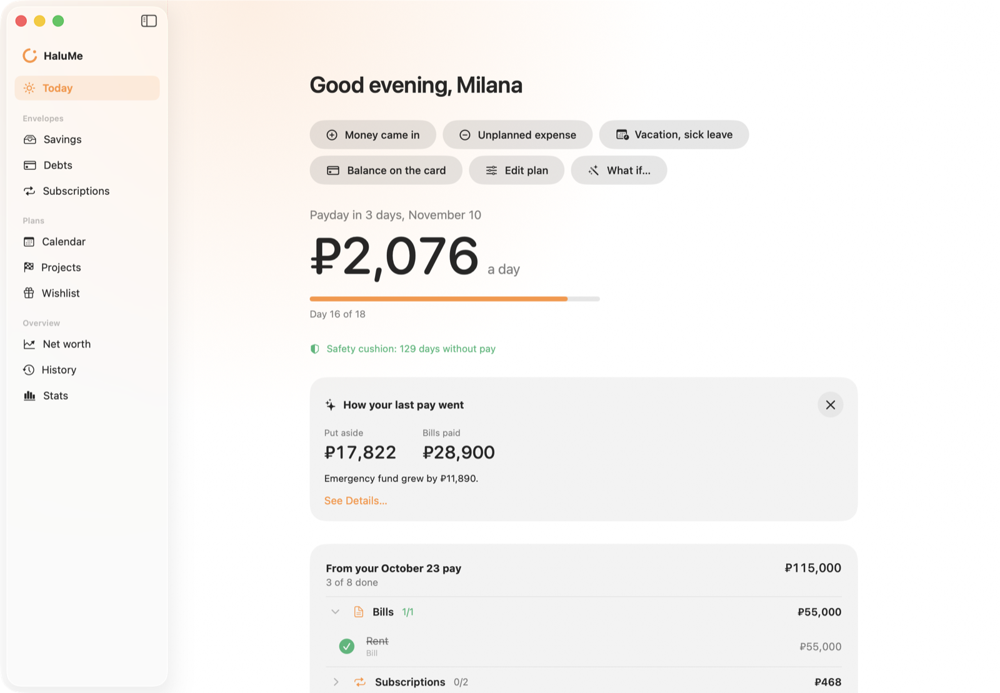
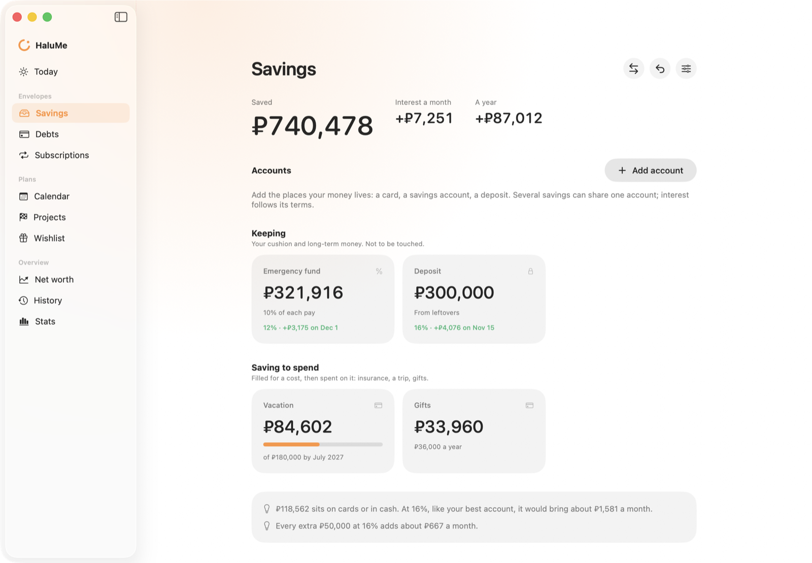
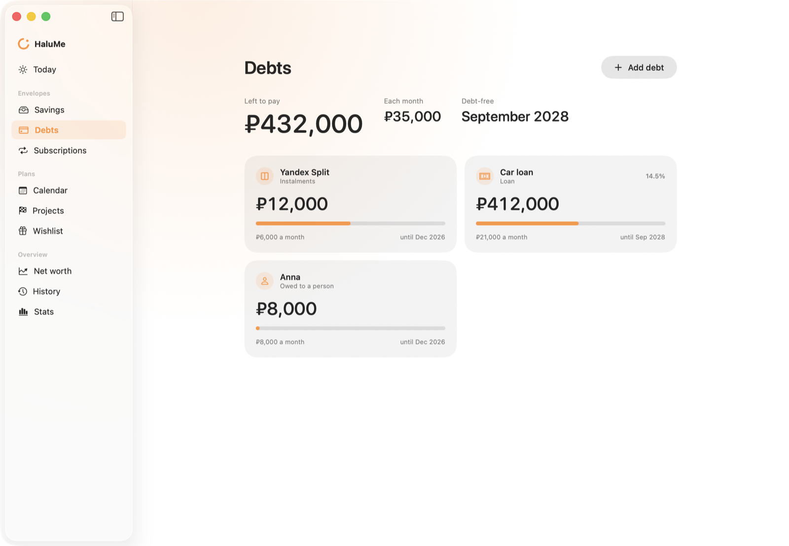
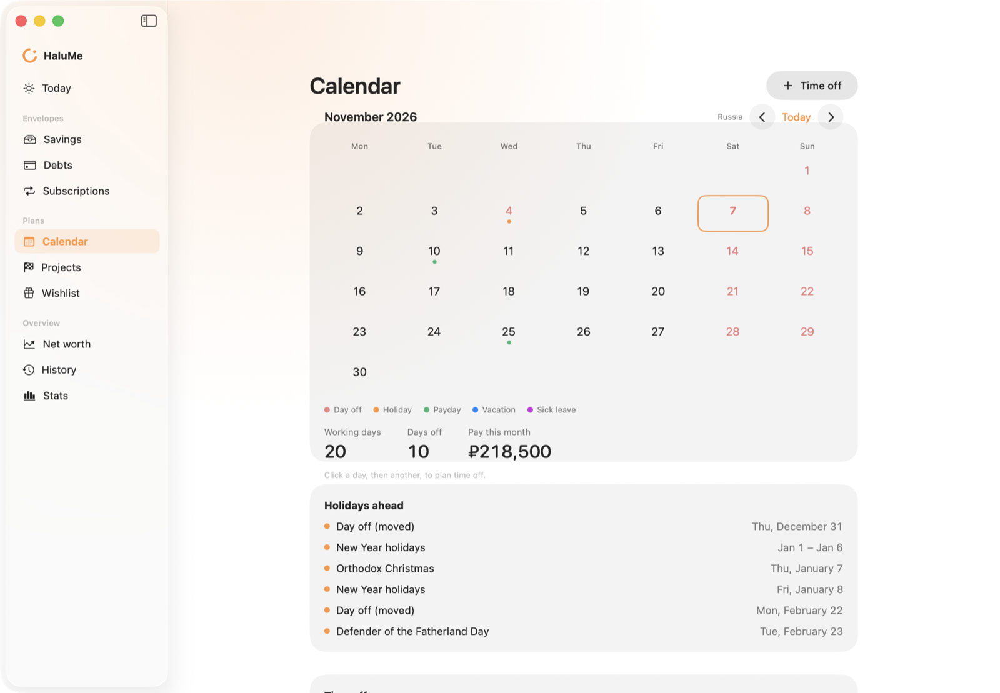
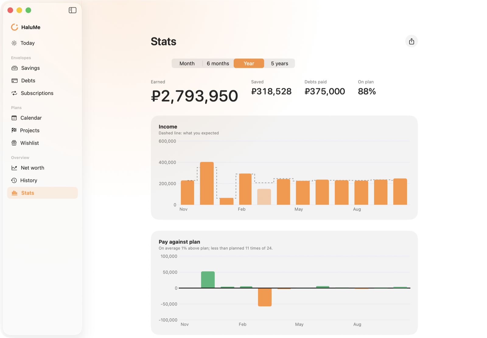
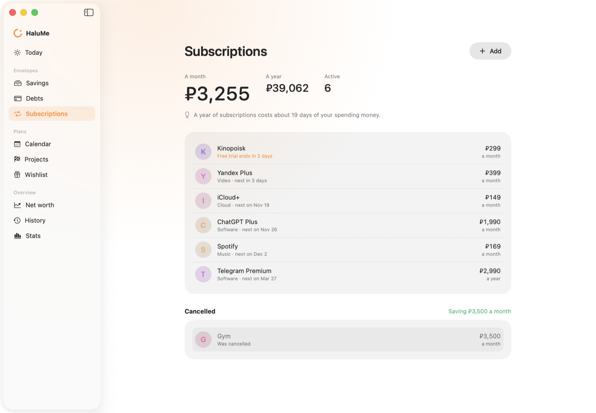
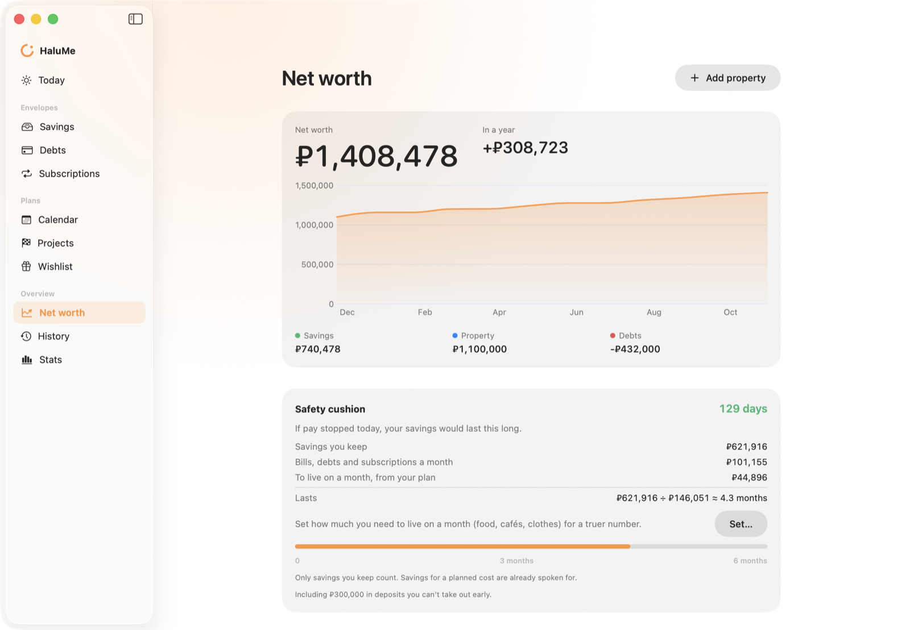
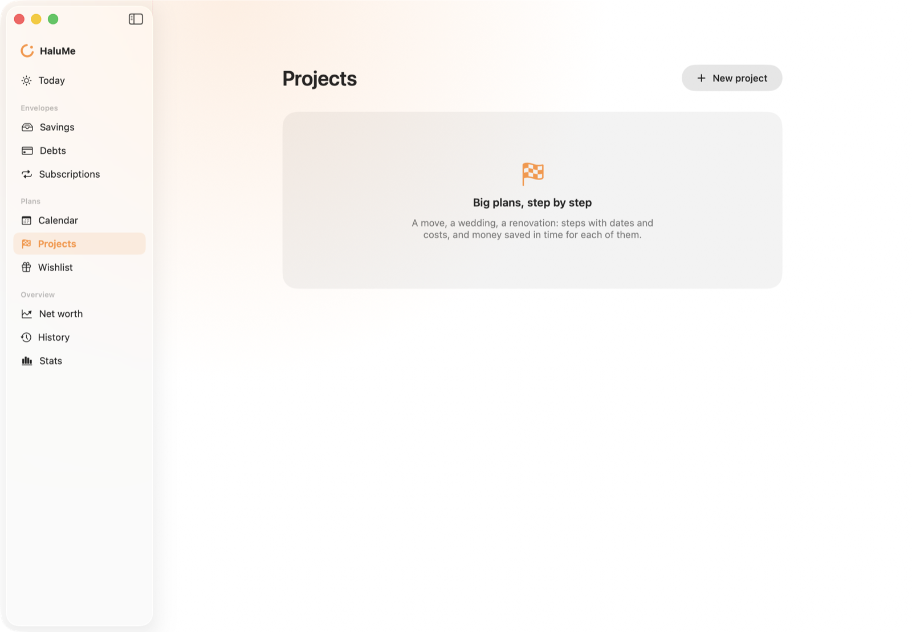
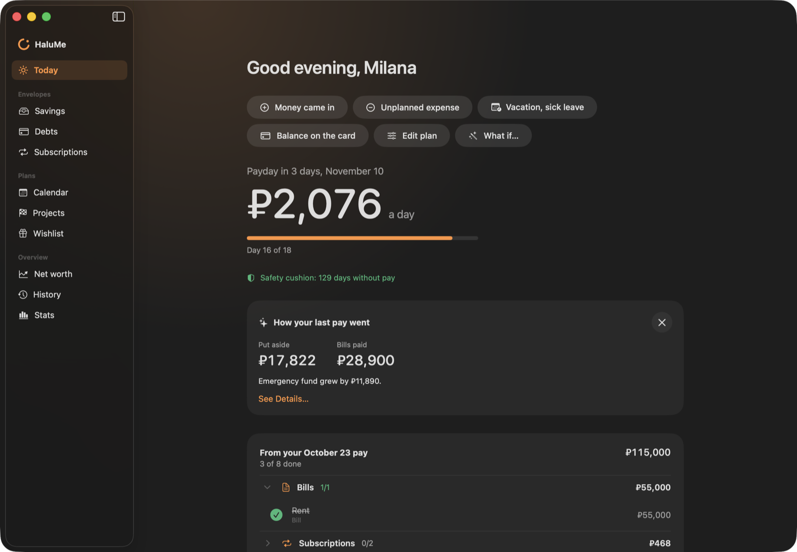
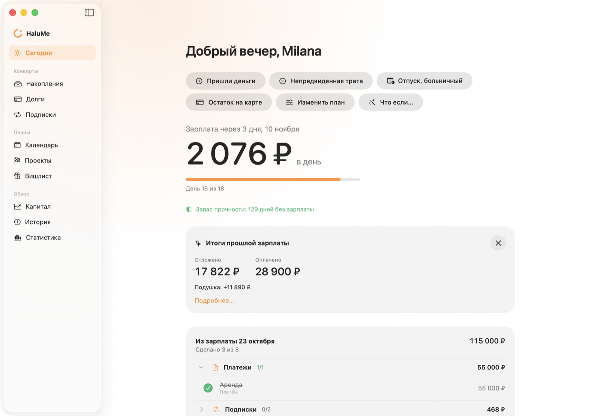

<p align="center">
  
</p>

<h1 align="center">HaluMe</h1>

<p align="center"><b>Plan your money once per payday — and know how much you can spend each day.</b><br>
A paycheck planner for macOS. No expense logging, no bank connections. English and Russian.</p>

---

## The idea

Few people keep logging every coffee past a few weeks. Decisions made in advance stick: automatic saving, labelled envelopes, a plan for each pay.

So HaluMe plans **from one payday to the next**, not by calendar month. When pay arrives you see where it goes — bills, debts, subscriptions, savings — and what's left becomes the main number:

> **₽2,076 a day until payday**

Spend it however you like. Something unplanned came in or went out? One tap, and "a day" recomputes.

## What it does

| | |
|---|---|
| **Paydays** | Salary on given days or every N weeks, split between two paydays by working days, equally or with a fixed advance. Paydays on a day off move to the working day before. |
| **Envelopes** | Bills, subscriptions and debts take money first; then savings: a target by a date, a percent of pay, a fixed sum, a yearly cost. Three kinds: money that leaves, saving to spend, keeping. |
| **Debts** | Instalments, loans, mortgages, cards, money owed to a person. Payoff calculator: pay more each month or once now — shorter term or smaller payment, months and interest saved. |
| **Subscriptions** | Price, cycle, next charge, free trial end, review every 3 months, "cancelled — saving X a month". |
| **Accounts** | Cards, savings accounts, deposits with rates and payout days; interest accrues daily. Monthly check: what the bank shows vs. what the envelopes expect. |
| **Time off & taxes** | Vacation and sick pay (Russian rules built in), production calendars for RU/BY/KZ/UZ and public holidays elsewhere. Income tax for Russia, Canada (all provinces) and the US. |
| **Projects & wishes** | Big goals as a plan and a budget (moving abroad, a wedding) with their own fund; a wishlist shared with the household. |
| **Overview** | Net worth, safety cushion ("129 days without pay"), history of everything outside the plan, stats by month / 6 months / year / 5 years, CSV export. |
| **Households** | One budget for one person, a couple or a partly shared budget: every cost is owned by someone or split equally, by income or by weights. |

## Screenshots

<table>
  <tr>
    <td></td>
    <td></td>
  </tr>
  <tr>
    <td align="center"><sub>Savings — keeping vs. saving to spend, interest ahead</sub></td>
    <td align="center"><sub>Debts — what's left and when it ends</sub></td>
  </tr>
  <tr>
    <td></td>
    <td></td>
  </tr>
  <tr>
    <td align="center"><sub>Calendar — production calendar, paydays, time off</sub></td>
    <td align="center"><sub>Stats — income vs. expected, pay against plan</sub></td>
  </tr>
  <tr>
    <td></td>
    <td></td>
  </tr>
  <tr>
    <td align="center"><sub>Subscriptions — next charges and what they cost a year</sub></td>
    <td align="center"><sub>Net worth — savings, assets, debts, runway</sub></td>
  </tr>
  <tr>
    <td></td>
    <td></td>
  </tr>
  <tr>
    <td align="center"><sub>Projects — stages, tasks, a fund for each goal</sub></td>
    <td align="center"><sub>Dark mode</sub></td>
  </tr>
</table>

<p align="center"><br><sub>По-русски</sub></p>

## Build and run

Requires macOS 15 and Swift 6 (Command Line Tools are enough, no Xcode project). No dependencies.

```bash
scripts/build.sh            # builds build/HaluMe.app
scripts/build.sh --install  # and copies it to ~/Applications
```

Try it on demo data (nothing is saved):

```bash
build/HaluMe.app/Contents/MacOS/HaluMe --demo --section today
```

Options: `--dark` / `--light`, `--section today|savings|debts|subscriptions|calendar|projects|wishlist|worth|history|stats`, `--sheet pay|balance|plan|debt|payoff|subscription|withdraw`. Russian: add `-AppleLanguages "(ru)" -AppleLocale ru_RU`.

Your budget lives in `~/Library/Application Support/HaluMe/budget.json`; `--data <folder>` keeps a test budget apart.

## Checks

```bash
swift run money-check        # assert-based checks of the planning engine
scripts/check-strings.sh     # every UI string has a Russian translation
```

## Code

```
Sources/HaluMeCore   models, the planning engine, stats, taxes — no UI, shared by every platform
Sources/HaluMe       the Mac app (SwiftUI)
Checks               money-check
Resources            Info.plist, icon, en/ru strings
docs                 the method, work lists, QA rounds
```

## Roadmap

CloudKit sync and partner sharing → iPhone app and widget → Apple Watch → a glance in the Halu notch app.

---

<sub>Tips in the app are plain arithmetic on your own rates — never product or investment advice.</sub>
